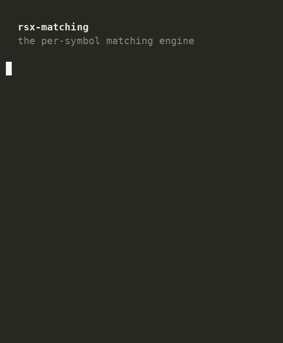

# rsx-matching

The matching engine: it pairs orders. An incoming buy that meets a
resting sell (or a sell that meets a resting buy) becomes a fill; an
order that doesn't cross rests in the book and waits. One process per
symbol. It takes orders from Risk, matches them against the book
(`rsx-book`), records the fills to the WAL, and tells Risk and
Marketdata what happened. On the 2026-07-16 shared-host run, the in-process
one-fill accept fixture (dedup, buffered WAL append without flush, match,
event write, index) had a **256.25 ns median** and measured **3.9568M
orders/s**. The match stayed in the same observed 46.343–49.491 ns band from 1 to
100k resting orders. These are in-process Criterion compute floors, not
exchange latency or production throughput. Numbers and method:
[`reports/20260716_book-matching-publication.md`](../reports/20260716_book-matching-publication.md).



Reproduce it with `cd rsx-matching/demo && make rec gif`; see [`demo/`](demo/)
for the script and caveats.

## What It Does

Receives orders from Risk via casting/UDP, matches against the
orderbook (rsx-book), writes events to WAL, fans out to Risk
and Marketdata via casting/UDP. Maintains an `FxHashMap<(user_id,
oid_hi, oid_lo), slab_handle>` so cancels are O(1) instead of
a linear slab scan; the index is updated from `book.events()`
after every match cycle (insert on `OrderInserted`, remove on
`OrderDone`).

## Running

```
RSX_ME_SYMBOL_ID=1 \
RSX_ME_TICK_SIZE=100 \
RSX_ME_LOT_SIZE=1000 \
RSX_ME_PRICE_DECIMALS=2 \
RSX_ME_QTY_DECIMALS=3 \
RSX_ME_CORE_ID=2 \
RSX_ME_WAL_DIR=./tmp/wal \
RSX_ME_CAST_ADDR=127.0.0.1:9100 \
RSX_RISK_CAST_ADDR=127.0.0.1:9000 \
RSX_MD_CAST_ADDR=127.0.0.1:9300 \
RSX_ME_DATABASE_URL=postgres://... \
cargo run -p rsx-matching
```

## Environment Variables

| Env Var | Purpose |
|---------|---------|
| `RSX_ME_SYMBOL_ID` | Symbol ID (u32) |
| `RSX_ME_TICK_SIZE` | Tick size in raw units |
| `RSX_ME_LOT_SIZE` | Lot size in raw units |
| `RSX_ME_PRICE_DECIMALS` | Price decimal places |
| `RSX_ME_QTY_DECIMALS` | Qty decimal places |
| `RSX_ME_CORE_ID` | CPU core to pin to |
| `RSX_ME_WAL_DIR` | WAL directory |
| `RSX_ME_CAST_ADDR` | casting bind address |
| `RSX_RISK_CAST_ADDR` | Risk casting address |
| `RSX_MD_CAST_ADDR` | Marketdata casting address |
| `RSX_ME_DATABASE_URL` | Postgres URL for config polling |
| `RSX_ME_REPLICATION_BIND_ADDR` | replication sidecar address |

## Deployment

- One instance per symbol (e.g. BTC-PERP, ETH-PERP)
- Pin to dedicated CPU core (`RSX_ME_CORE_ID`)
- Needs WAL directory with write access
- Needs Postgres for config schedule polling
- Connects to Risk and Marketdata via casting/UDP

## Invariants

Hot-path `.expect()` messages cite named invariants from
`specs/2/6-consistency.md` so panic messages map directly to
the spec rule that was broken. Examples:

- `wal append failed (order-accepted) — violates invariant 7
  (WAL persistence) and breaks dedup on replay`
- `wal append failed (event path) — violates invariant 1
  (totally-ordered events) and 'Fills precede ORDER_DONE'`
- `wal append failed (cancel path) — violates invariant 1
  and invariant 5 (ORDER_DONE commit boundary)`

## Testing

```
cargo test -p rsx-matching
```

10 test files: config, config_poll, event, invariant,
lifecycle, order_processing, position, smooshed,
wal, wire. Dedup boundary logic validated.
See `specs/2/41-testing-matching.md`.

## Dependencies

- `rsx-book` -- orderbook and matching algorithm
- `rsx-cast` -- WAL writer, casting sender/receiver
- `rsx-types` -- shared types
- Postgres (runtime, for config polling)

## Gotchas

- Config updates are polled from Postgres every 10 minutes,
  not pushed. There is a delay between config change and
  application.
- Dedup window is 1 hour. Retries after 1 hour will
  be treated as new orders.
- WAL flush is every 10ms. Events are not durable until
  the next flush.

## See Also

- [ARCHITECTURE.md](ARCHITECTURE.md) -- main loop, dedup,
  config hot reload, event fanout
- `specs/2/17-matching.md`
